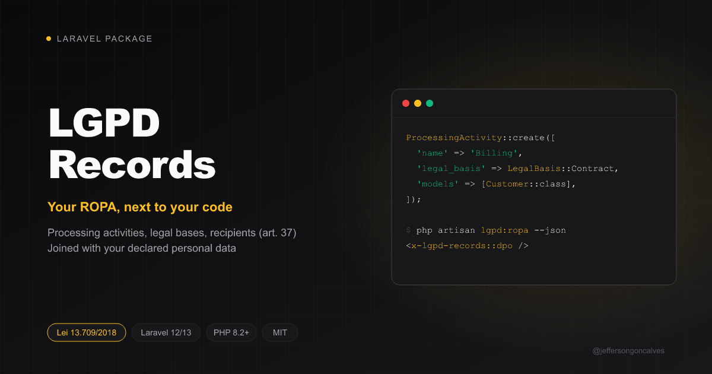

# Laravel LGPD Records



[](https://packagist.org/packages/jeffersongoncalves/laravel-lgpd-records)
[](https://github.com/jeffersongoncalves/laravel-lgpd-records/actions/workflows/tests.yml)
[](https://packagist.org/packages/jeffersongoncalves/laravel-lgpd-records)

The Brazilian General Data Protection Law (LGPD, Lei 13.709/2018) asks controllers to keep records of their processing operations (art. 37, the ROPA). It also asks them to publish the identity and contact of their data protection officer, the *encarregado* (art. 41). This package stores your processing activities and joins each one with the columns you declared in [laravel-lgpd](https://github.com/jeffersongoncalves/laravel-lgpd). Your records follow your code.

> This package gives you tooling. It does not make you compliant on its own. Your records need legal review.

## Installation

```bash
composer require jeffersongoncalves/laravel-lgpd-records
php artisan vendor:publish --tag="lgpd-records-migrations"
php artisan migrate
```

```dotenv
LGPD_CONTROLLER_NAME="Acme Ltda"
LGPD_CONTROLLER_DOCUMENT="00.000.000/0001-00"
LGPD_DPO_NAME="Ana Souza"
LGPD_DPO_EMAIL=dpo@acme.com.br
```

## Processing activities

```php
use JeffersonGoncalves\Lgpd\Enums\LegalBasis;
use JeffersonGoncalves\LgpdRecords\Models\ProcessingActivity;

ProcessingActivity::create([
    'name' => 'Billing',
    'purpose' => 'Issue invoices and collect payments',
    'legal_basis' => LegalBasis::Contract,
    'data_subjects' => ['customers'],
    'models' => [Customer::class],                     // its #[PersonalData] columns join the record
    'data_categories' => ['payment history'],          // anything not declared on a model
    'recipients' => [['name' => 'Stripe', 'role' => 'processor', 'country' => 'US']],
    'international_transfers' => [['country' => 'US', 'mechanism' => 'standard_clauses']],
    'retention' => '5 years after the end of the contract',
    'security_measures' => 'Encryption at rest, role-based access, audit log',
]);
```

- `role`: `processor` (*operador*), `controller` (shared controller) or `public_authority`.
- `mechanism`: the legal ground for the transfer (art. 33), such as `adequacy`, `standard_clauses`, `binding_corporate_rules` or `specific_consent`.

## Export

```bash
php artisan lgpd:ropa          # one row per activity
php artisan lgpd:ropa --json   # controller, DPO and every activity, ready to hand to the ANPD
```

```php
LgpdRecords::export();   // the same, as an array
```

The command warns you when the DPO contact is missing.

## Data protection officer

Publish the *encarregado*'s identity and contact on your website (art. 41, §1):

```blade
<x-lgpd-records::dpo label="Encarregado" class="text-sm" />
```

It renders the name, a `mailto:` link and a `tel:` link, and renders nothing until a DPO is configured.

## Privacy policy

Your privacy notice must tell data subjects, clearly, the purpose, legal basis, duration and recipients of each processing, plus their rights (arts. 9 and 18). The records already hold all of that, so render the notice from them:

```blade
{{-- resources/views/privacy.blade.php, inside your layout --}}
<x-lgpd-records::privacy-policy rights-url="{{ route('privacy.requests') }}" class="prose" />
```

It renders the controller, the DPO, one section per processing activity, the art. 18 rights and the right to complain to the ANPD. Each activity lists its purpose, legal basis, data (its `data_categories` plus its declared columns, flagged when sensitive), data subjects, recipients, international transfers and retention. The last-updated date comes from the activities, so the notice changes when your records change. Without `rights-url` it points readers to the DPO.

Texts ship in English and Brazilian Portuguese and follow the app locale. Publish them (`--tag="lgpd-records-translations"`) or the view (`--tag="lgpd-records-views"`) to change the wording. The markup is plain semantic HTML with no styles, so your CSS (or `prose`) decides how it looks.

> Generating the notice from the records keeps the two in sync. It still needs legal review, like the records themselves.

## Testing

```bash
composer test
```

## Changelog

See [CHANGELOG](CHANGELOG.md).

## License

The MIT License (MIT). See [License File](LICENSE.md).
